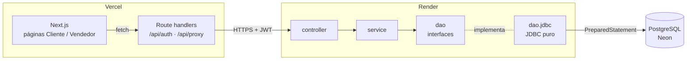
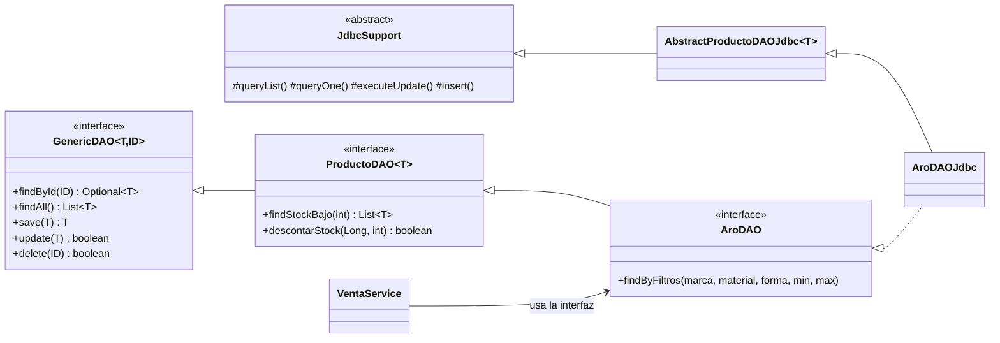
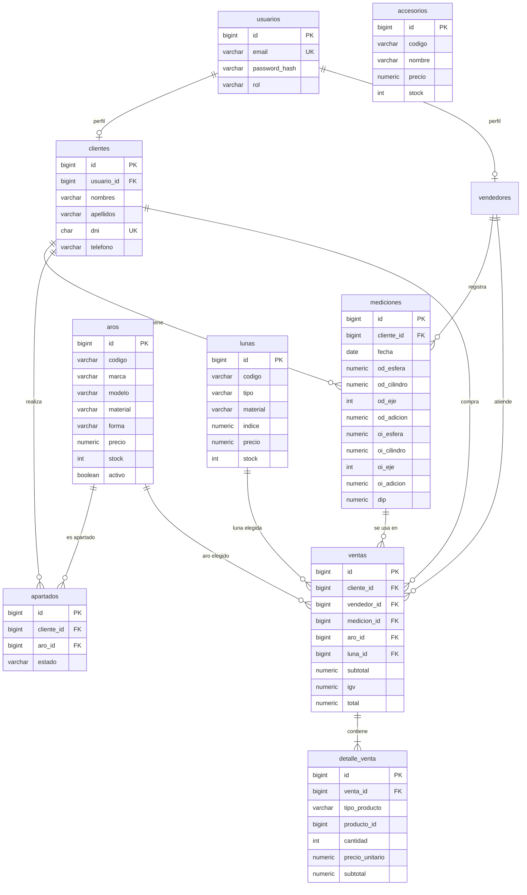
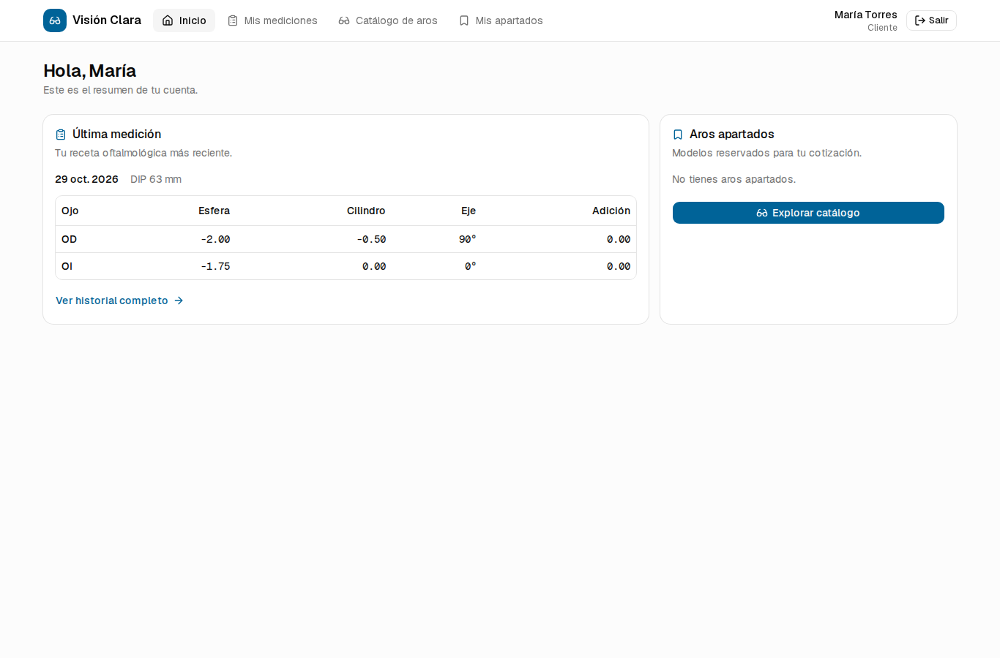
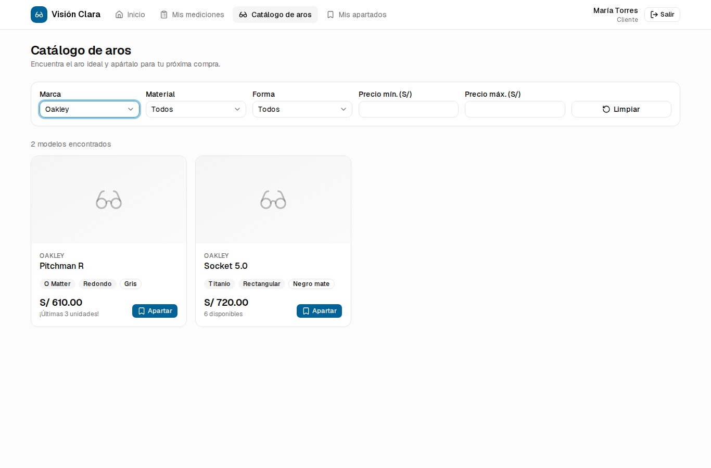
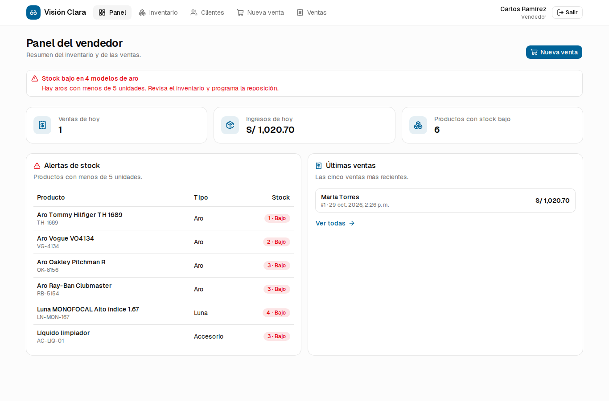
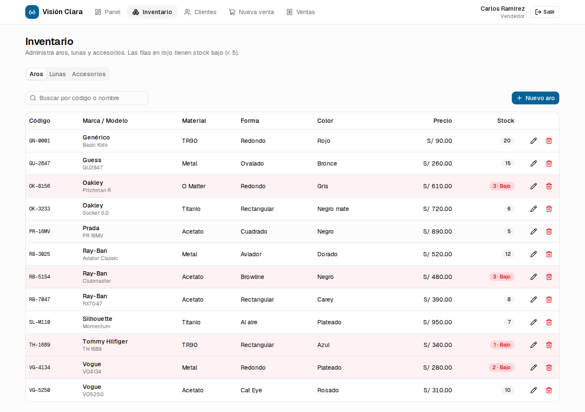
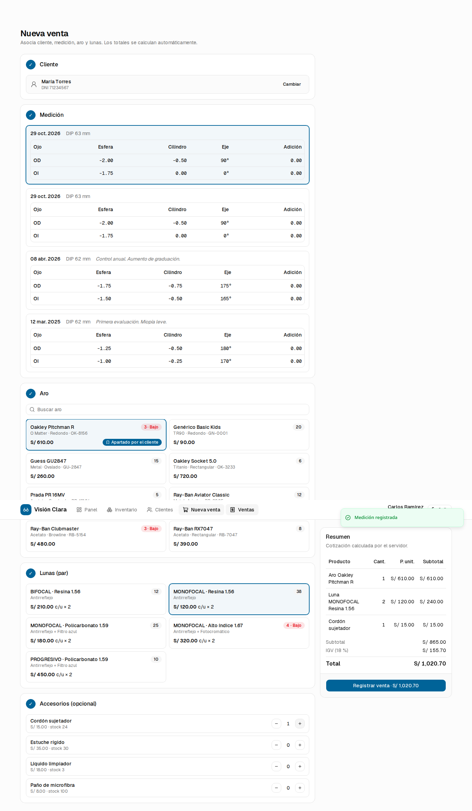
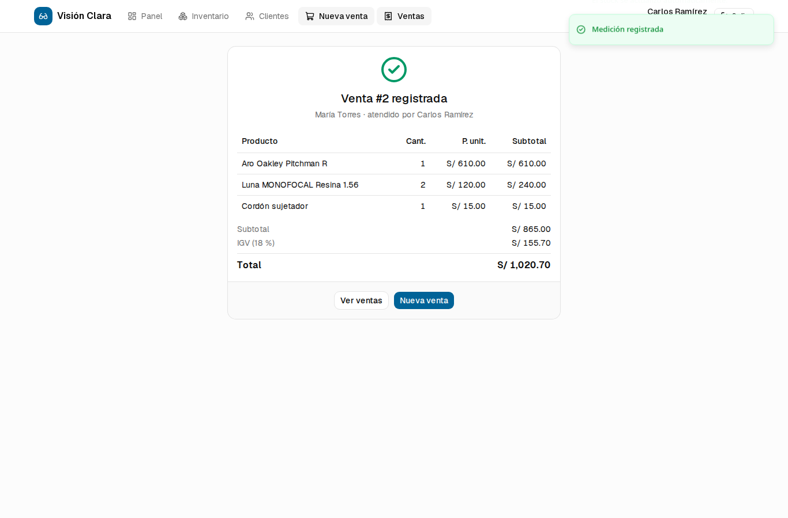

# Informe del proyecto: Sistema de Gestión de Óptica

**Proyecto:** Óptica Visión Clara
**Arquitectura:** DAO (Data Access Object) con JDBC
**Fecha:** octubre de 2026

## Enlaces de entrega

| Recurso | Enlace |
|---|---|
| Repositorio Git — Backend (Spring Boot) | `<URL_REPO_BACKEND>` |
| Repositorio Git — Frontend (Next.js) | `<URL_REPO_FRONTEND>` |
| Aplicación desplegada (Vercel) | `<URL_VERCEL>` |
| API desplegada (Render) | `<URL_RENDER>` |
| Base de datos | Neon — PostgreSQL serverless |

**Cuentas de prueba** (contraseña `123456`): `vendedor@optica.com` · `cliente@optica.com`

---

## 1. Objetivo

Desarrollar una aplicación web en Java con arquitectura DAO para gestionar los procesos de una óptica:

- Los **clientes** autogestionan sus consultas: registro, historial de mediciones y elección o apartado de aros.
- Los **vendedores** administran el inventario y procesan las ventas.
- Todos los datos persisten en una base de datos relacional (PostgreSQL).

## 2. Tecnologías

| Capa | Tecnología | Justificación |
|---|---|---|
| Backend | Java 21, Spring Boot 4.1 (Web MVC, Security, Validation) | Ecosistema estándar de Java para APIs REST. Spring solo provee la infraestructura (HTTP, inyección de dependencias, transacciones). El acceso a datos es **JDBC puro**. |
| Acceso a datos | JDBC (`java.sql`) + HikariCP | Requisito del patrón DAO con JDBC. **No se usa JPA/Hibernate ni JdbcTemplate.** |
| Migraciones | Flyway | Versiona el esquema SQL y los datos de prueba. |
| Seguridad | Spring Security + JWT (HS256), BCrypt | Autenticación sin estado y control de acceso por rol. |
| Base de datos | PostgreSQL 16 (Docker en local, Neon en producción) | Modelo relacional con integridad referencial, `CHECK` y transacciones. |
| Frontend | Next.js 16, React 19, TypeScript, Tailwind CSS, shadcn/ui | Interfaz moderna y adaptable a móviles. |
| Pruebas | JUnit 5, Mockito, Testcontainers | Pruebas unitarias de la lógica de negocio y de integración de los DAO contra un PostgreSQL real. |

## 3. Arquitectura



### 3.1 Paquetes del backend (patrón DAO)

| Paquete | Contenido |
|---|---|
| `com.optica.model` | Clases de negocio puras (POJOs sin anotaciones): `Usuario`, `Rol`, `Cliente`, `Vendedor`, `Medicion`, `Producto` (abstracta), `Aro`, `Luna`, `Accesorio`, `Apartado`, `Venta`, `DetalleVenta`. |
| `com.optica.dao` | **Interfaces**, es decir, los contratos. `GenericDAO<T, ID>` define el CRUD. `ProductoDAO<T>` agrega `findStockBajo` y `descontarStock`. Además hay contratos específicos: `AroDAO.findByFiltros`, `MedicionDAO.findByCliente`, `VentaDAO`, etc. |
| `com.optica.dao.jdbc` | **Implementaciones JDBC**: `UsuarioDAOJdbc`, `ClienteDAOJdbc`, `AroDAOJdbc`, `VentaDAOJdbc`, etc. `JdbcSupport` centraliza la apertura y el cierre de conexiones y la ejecución de `PreparedStatement`. `AbstractProductoDAOJdbc` reúne la lógica común de las tres tablas de productos. |
| `com.optica.service` | **Lógica de negocio**. Coordina varios DAO, valida reglas y define las transacciones. |
| `com.optica.controller` | Endpoints REST. Solo traducen HTTP ↔ servicio. |
| `com.optica.dto` | Objetos de petición y respuesta con validaciones (`@NotBlank`, `@Pattern`, …). |
| `com.optica.security` | Emisión y validación de JWT, configuración de roles. |
| `com.optica.exception` | Excepciones de negocio y `GlobalExceptionHandler`, que las convierte en respuestas JSON. |



Los servicios dependen solo de las **interfaces** DAO. Spring inyecta la implementación JDBC, así que la
fuente de datos se puede cambiar sin tocar la lógica de negocio. En las pruebas unitarias, por ejemplo,
los DAO se reemplazan por *mocks*.

### 3.2 Ejemplo de implementación JDBC

```java
// AbstractProductoDAOJdbc.descontarStock
// La condición stock >= ? evita stock negativo incluso con ventas concurrentes
return executeUpdate("UPDATE " + tabla() + " SET stock = stock - ? WHERE id = ? AND activo AND stock >= ?",
        cantidad, id, cantidad) > 0;
```

```java
// JdbcSupport.queryList: JDBC puro con try-with-resources
Connection con = getConnection();
try (PreparedStatement ps = con.prepareStatement(sql)) {
    setParams(ps, params);
    try (ResultSet rs = ps.executeQuery()) {
        List<T> lista = new ArrayList<>();
        while (rs.next()) lista.add(mapper.map(rs));
        return lista;
    }
} catch (SQLException e) {
    throw new DAOException("Error al consultar", e);
} finally {
    release(con);
}
```

### 3.3 Transacciones

Los DAO obtienen la conexión con `DataSourceUtils.getConnection(dataSource)`. Cuando un servicio está
anotado con `@Transactional`, todos los DAO que invoca comparten **la misma conexión JDBC**. Así, si
falla cualquier paso, se hace *rollback* de todo. Esto se aplica en:

- `AuthService.registrarCliente`: crea el `usuario` y el `cliente`.
- `VentaService.registrar`: guarda la venta y su detalle, y descuenta el stock del aro, las lunas y los accesorios.

## 4. Modelo de datos



Decisiones de diseño:

- **Integridad en la base de datos:** `CHECK (stock >= 0)`, eje entre 0 y 180°, DNI de 8 dígitos y claves foráneas obligatorias en `ventas`.
- **Borrado lógico de productos** (`activo = false`): las ventas anteriores conservan sus referencias. El código del producto es único solo entre productos activos (índice único parcial), así que un código dado de baja puede reutilizarse.
- **Mediciones** almacenadas por ojo: OD (derecho) y OI (izquierdo), con esfera, cilindro, eje y adición, más la distancia interpupilar (DIP).

## 5. Módulos implementados

### 5.1 Seguridad y acceso (transversal)

- **Login:** valida correo y contraseña. Las contraseñas se guardan con hash BCrypt.
- **JWT:** el backend emite un token firmado con los claims `rol`, `uid` (usuario) y `pid` (id de cliente o vendedor).
- **Control de roles en el backend:** `/api/cliente/**` exige `ROLE_CLIENTE` y `/api/vendedor/**` exige `ROLE_VENDEDOR`. Si no se cumple, la respuesta es 403.
- **Redirección automática:** después del login, el frontend envía al usuario a `/cliente` o a `/vendedor` según su rol. `proxy.ts` impide entrar a la interfaz del otro rol.
- **Seguridad del token en el navegador:** el JWT se guarda en una cookie *httpOnly*. Un *route handler* de Next.js reenvía las llamadas a la API, así JavaScript nunca accede al token.

### 5.2 Módulo del cliente

| Requisito | Implementación |
|---|---|
| Registro (nombre, DNI, teléfono, correo) | `/registro` → `POST /api/auth/registro`. Valida DNI y correo únicos. |
| Historial de mediciones | `/cliente/mediciones` → `GET /api/cliente/mediciones`, en tabla clínica OD/OI. |
| Catálogo filtrado por marca, material, forma y precio | `/cliente/catalogo` → `GET /api/catalogo/aros?...`. La consulta SQL se arma dinámicamente con parámetros `?`. |
| Apartar un aro | `POST /api/cliente/apartados`. Se consulta en `/cliente/apartados` y se puede cancelar. |

### 5.3 Módulo del vendedor

| Requisito | Implementación |
|---|---|
| CRUD de aros, lunas y accesorios | `/vendedor/inventario` (pestañas) → `GET/POST/PUT/DELETE /api/vendedor/{aros,lunas,accesorios}`. |
| Alerta de stock bajo (< 5) | `GET /api/vendedor/alertas-stock`. Se muestra un aviso en el panel y las filas en rojo en el inventario. El umbral se configura con `STOCK_UMBRAL`. |
| Venta asociada a cliente, medición y aro | `/vendedor/ventas/nueva` → `POST /api/vendedor/ventas`. Valida que la medición pertenezca al cliente. |
| Cálculo automático de subtotal, IGV y total | `VentaService.calcularTotales`: subtotal = Σ líneas; IGV = 18 % (`IGV_RATE`); total = subtotal + IGV. La vista previa en vivo usa `POST /cotizar`. |
| Descuento automático de stock | En la misma transacción: aro −1, lunas −2 (un par) y accesorios −n. Si no alcanza el stock, se revierte todo. |
| Extra | Registro de mediciones por el vendedor, historial de ventas con detalle y marcado del apartado como VENDIDO. |

## 6. Capturas

| | |
|---|---|
|  |  |
| Inicio del cliente | Catálogo filtrado por marca |
|  |  |
| Panel con alertas de stock | CRUD de inventario |
|  |  |
| Asistente de venta con cotización | Venta registrada |

## 7. Despliegue

### 7.1 Elección de plataformas

| Componente | Plataforma | Por qué |
|---|---|---|
| Base de datos | **Neon** (PostgreSQL) | El proyecto es **relacional**: usa claves foráneas, `CHECK`, transacciones e índices parciales. Turso usa SQLite y MongoDB es documental, así que ninguno es compatible con el driver JDBC de PostgreSQL ni con este esquema. Neon ofrece PostgreSQL administrado gratis, sin fecha de expiración, y con conexión SSL. |
| Backend | **Render** (Web Service, Docker) | Ejecuta contenedores Java de forma gratuita con HTTPS. Vercel y GitHub Pages no pueden ejecutar una JVM de larga duración. |
| Frontend | **Vercel** | Es la plataforma nativa de Next.js: soporta *route handlers*, `proxy.ts` y despliegue automático desde Git. |

### 7.2 Pasos

1. **Neon:** crear un proyecto y una base de datos `optica`. De la cadena de conexión se obtienen:
   - `DB_URL = jdbc:postgresql://<host>.neon.tech/optica?sslmode=require`
   - `DB_USER` y `DB_PASSWORD`
2. **Render:** *New → Blueprint* (usa `render.yaml`) o *New → Web Service → Docker* con el repositorio del backend.
   - Definir `DB_URL`, `DB_USER`, `DB_PASSWORD`, `JWT_SECRET` (al menos 32 caracteres) y `CORS_ORIGINS`.
   - Al arrancar, Flyway crea las tablas y los datos de demostración.
   - Health check: `/actuator/health`.
3. **Vercel:** importar el repositorio del frontend y definir `BACKEND_URL=https://<servicio>.onrender.com`.
4. Agregar la URL de Vercel a `CORS_ORIGINS` en Render.

> **Nota:** el plan gratuito de Render suspende el servicio tras 15 minutos sin tráfico. La primera petición después de eso puede tardar unos 50 segundos en responder.

## 8. Pruebas

- `VentaServiceTest` (Mockito):
  - cálculo de subtotal, IGV y total, y agrupación de accesorios repetidos;
  - rechazo de una medición que pertenece a otro cliente;
  - rechazo por stock insuficiente de lunas;
  - error cuando el descuento de stock no afecta filas.
- `DaoJdbcIntegrationTest` (Testcontainers + PostgreSQL 16):
  - CRUD de aro con borrado lógico y reutilización del código;
  - filtros del catálogo y alertas de stock;
  - `descontarStock` nunca deja stock negativo;
  - la venta descuenta 1 aro y 2 lunas;
  - una venta sin stock no modifica nada.
- Prueba E2E con navegador: registro, login por rol, filtros, apartado, CRUD, registro de medición y venta completa.

```bash
./mvnw test   # Tests run: 10, Failures: 0, Errors: 0
```

## 9. Ejecución local

```bash
# Backend
cd optica-backend
docker compose up -d db
./mvnw spring-boot:run

# Frontend
cd optica-frontend
cp .env.example .env.local
npm install && npm run dev   # http://localhost:3000
```
